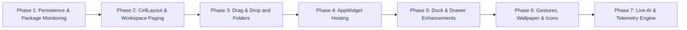

# LauncherAI – Reference Feature Implementation Audit

**Audit Date:** November 17, 2026  
**Reference Codebase:** `D:\DEMO\Nova Launcher Demo\Nova Launcher\app` (Decompiled Nova Launcher v8.9.6)  
**Target Codebase:** `D:\DEMO\Nova Launcher Demo\LauncherAI` (LauncherAI Android Kotlin Project)  
**Scope:** Activities, Fragments, ViewModels, Repositories, Adapters, Services, Receivers, Manifests, Layouts, Drawables, Dependencies, and Live Android Runtime API Connections.

---

## 1. Executive Summary

A deep comparative technical audit was conducted between the decompiled reference codebase of **Nova Launcher (v8.9.6 / build 89600)** and the current **LauncherAI** implementation. 

While the installed `LauncherAI` APK compiles and launches without fatal crashes, runtime inspection on a physical Android device reveals that **LauncherAI is currently an early-stage prototype shell** rather than a functional home launcher. The app implements a static presentation layer for home screen shortcuts, dock icons, simulated AI responses, and informational screens, but lacks the core underlying subsystems of a production Android launcher (multi-page paged workspace, drag-and-drop coordinator, AppWidget hosting, folder engines, custom icon packs, gesture handling, and persistent SQLite database storage). Furthermore, the AI chat and settings components do not connect to live backend services or device tools, operating entirely via hardcoded in-memory simulators.

### Implementation Status Breakdown

| Status Category | Count | Percentage |
| :--- | :---: | :---: |
| **Fully implemented and verified** | 1 | 4.5% |
| **Partially implemented** | 3 | 13.6% |
| **Implemented only as a static UI** | 3 | 13.6% |
| **Implemented but not connected to actual Android functionality** | 2 | 9.1% |
| **Not implemented** | 13 | 59.2% |
| **Total Functional Domains Audited** | **22** | **100%** |

---

## 2. Complete Feature Comparison Matrix

| # | Feature Domain | Reference Nova Source | LauncherAI File(s) | Current Status | Core Missing Implementation Details |
| :-: | :--- | :--- | :--- | :--- | :--- |
| **1** | **Multi-Page Workspace** | `com.android.launcher3.Workspace`<br>`com.android.launcher3.pageindicators.PageIndicator` | `MainActivity.kt`<br>`activity_main.xml` | **Not implemented** | Single vertical `ScrollView` instead of horizontal `PagedView`. No page indicators, multi-page snapping, overscroll bounce, or page reordering. |
| **2** | **Grid & CellLayout** | `com.android.launcher3.CellLayout`<br>`com.teslacoilsw.launcher.workspace.CrosshairsCellLayout` | `MainActivity.kt`<br>`item_app_grid.xml` | **Not implemented** | Uses standard `GridLayoutManager(this, 4)`. No cell coordinate system (`cellX`, `cellY`, `spanX`, `spanY`), subgrid positioning, or vacant-cell allocation matrix. |
| **3** | **Drag and Drop Architecture** | `com.android.launcher3.dragndrop.DragController`<br>`com.android.launcher3.dragndrop.DragLayer`<br>`com.android.launcher3.DropTargetBar`<br>`com.android.launcher3.DeleteDropTarget` | None | **Not implemented** | No `DragController`, `DragLayer`, or floating `DragView`. No drop targets (Remove, Uninstall, App Info) or touch coordinate interpolation. |
| **4** | **App Shortcuts & Deep Popups** | `com.android.launcher3.popup.PopupContainerWithArrow`<br>`com.android.launcher3.shortcuts.DeepShortcutManager`<br>`com.teslacoilsw.launcher.EditShortcutFloatingView` | `AppsAdapter.kt` | **Not implemented** | `onAppLongClick` is unhandled in `MainActivity.kt`. No popup menu, no Android `ShortcutManager` dynamic/pinned shortcut retrieval, no custom icon/label editor. |
| **5** | **Folder Management** | `com.android.launcher3.folder.Folder`<br>`com.android.launcher3.folder.FolderIcon`<br>`com.android.launcher3.folder.FolderPagedView`<br>`com.android.launcher3.folder.FolderInfo` | None | **Not implemented** | No folder data models, no folder icon preview generator (circular/grid/stack/fan), no drag-over-to-create folder logic, and no folder popup dialog/editor. |
| **6** | **App Drawer** | `com.android.launcher3.allapps.AllAppsContainerView`<br>`com.android.launcher3.allapps.AllAppsRecyclerView`<br>`com.teslacoilsw.launcher.launcher3.NovaAppDrawerSearchBar` | `MainActivity.kt`<br>`activity_main.xml`<br>`AppsAdapter.kt` | **Partially implemented** | Drawer overlay and live search filter by app name exist. Missing: alphabetical fast-scroller with section indicator, drawer folders, tabs/groups, and usage sorting. |
| **7** | **App Categorization & Hidden Apps** | `com.teslacoilsw.launcher.drawer.DrawerFolder`<br>`com.teslacoilsw.launcher.drawer.TabbedDrawer` | None | **Not implemented** | No drawer groups, custom tabs, work profile separation, or preference to hide specific applications from the drawer. |
| **8** | **Dock (Hotseat) System** | `com.teslacoilsw.launcher.Hotseat`<br>`com.android.launcher3.Hotseat` | `activity_main.xml`<br>`MainActivity.kt` | **Implemented only as a static UI** | 5 fixed slots (Phone, Messages, Drawer, Browser, Camera) hardcoded in XML. No user-rearrangeable dock, no multi-page dock, no custom background shapes/colors. |
| **9** | **Widget Hosting & Management** | `com.android.launcher3.widget.AppWidgetHost`<br>`com.android.launcher3.widget.WidgetsFullSheet`<br>`com.android.launcher3.AppWidgetResizeFrame` | `activity_main.xml` (Clock TextViews) | **Not implemented** | The clock is a hardcoded layout `TextView`, not an Android AppWidget. No `AppWidgetHost`, no widget picker dialog, no binding permissions, and no resizing handles. |
| **10** | **Wallpaper & Parallax Engine** | `com.android.launcher3.LauncherWallpaperPickerActivity`<br>`com.android.launcher3.WallpaperCropActivity`<br>`com.android.launcher3.Workspace#updatePageOffsets` | `activity_main.xml` | **Not implemented** | Uses a solid `#0F1117` background color. No `WallpaperManager` connection, no system wallpaper rendering, no multi-page scroll parallax offset, and no picker. |
| **11** | **Gesture Subsystem** | `com.teslacoilsw.launcher.NovaLauncher`<br>`com.teslacoilsw.launcher.screenoff.NovaScreenOff` | `MainActivity.kt` | **Not implemented** | Only handles a tap on the center dock button. No gesture detection for swipe-up, swipe-down, pinch, double-tap to lock, or two-finger actions. |
| **12** | **Icon Packs & Adaptive Icons** | `com.teslacoilsw.launcher.icon.IconThemePrompt`<br>`com.android.launcher3.icons.IconCache`<br>`com.android.launcher3.icons.BaseIconFactory` | `AppManager.kt` | **Not implemented** | `AppManager.kt` only fetches default `pm.loadIcon()`. No icon pack scanning (`com.anddoes.launcher.THEME`, etc.), no adaptive icon masking, and no icon scaling. |
| **13** | **Notification Badging & Dots** | `com.android.launcher3.notification.NotificationListener`<br>`com.android.launcher3.BadgeInfo` | None | **Not implemented** | No `NotificationListenerService` declaration or implementation. No dynamic numeric count badges or unread notification dots on app icons. |
| **14** | **Persistent Database (Workspace State)** | `com.android.launcher3.LauncherProvider`<br>`com.android.launcher3.model.LoaderTask`<br>`launcher.db (favorites table)` | None | **Not implemented** | No SQLite / Room database. Workspace items are in-memory slices (`apps.take(8)`). Any modifications or rearrangements are lost across app restarts. |
| **15** | **Package Lifecycle Monitoring** | `com.android.launcher3.model.PackageUpdatedTask`<br>`com.teslacoilsw.launcher.MyPackageReplacedReceiver` | None | **Not implemented** | No `BroadcastReceiver` for `ACTION_PACKAGE_ADDED`, `REMOVED`, or `CHANGED`. Installing or uninstalling apps while LauncherAI is running leaves the launcher in a stale state. |
| **16** | **Search Subsystem** | `com.teslacoilsw.launcher.search.Search`<br>`ninja.sesame.lib.bridge.v1.access.RelayActivity` | `MainActivity.kt` | **Partially implemented** | Top bar routes to drawer search or fires web search voice intent. No on-device contact search, deep app shortcut search, or Sesame integration. |
| **17** | **General Launcher Settings Hierarchy** | `com.teslacoilsw.launcher.novasettings.*`<br>`com.teslacoilsw.launcher.preferences.Pref3` | `NovaAiSettingsActivity.kt` | **Not implemented** | Only AI settings exist. Settings for Desktop grid size, icon size, drawer behavior, dock styling, night mode, gestures, and integrations are completely missing. |
| **18** | **Backup & Restore Engine** | `com.teslacoilsw.launcher.backup.BackupManager`<br>`com.teslacoilsw.launcher.RestoreBackupFileHandler` | None | **Not implemented** | No mechanism to export or import desktop layout configurations, widget layouts, or custom settings. |
| **19** | **Nova AI Conversational Chat** | `com.teslacoilsw.launcher.ai.NovaAiChatActivity`<br>`com.instabridge.ai.chat.ui.v2.AiChatViewV2` | `NovaAiChatActivity.kt`<br>`activity_ai_chat.xml`<br>`ChatAdapter.kt` | **Implemented only as a static UI** | Rich visual chat UI with user/AI bubbles, collapsible reasoning, and tool cards is implemented. However, backend responses are **canned static strings** delayed via `Handler.postDelayed()`. |
| **20** | **Nova AI Real-Time Agent & Tool Calling** | `com.instabridge.ai.client.AiClient`<br>`com.instabridge.ai.bridge.AiWebBridge` | `NovaAiChatActivity.kt` | **Implemented only as a static UI** | Tool call cards are hardcoded string displays inside fake responses. No real network streaming (SSE), no WebSocket, and no executable tool calling into Android APIs. |
| **21** | **Nova AI Settings & Telemetry Controls** | `com.teslacoilsw.launcher.ai.NovaAiSettingsActivity`<br>`com.teslacoilsw.launcher.preferences.Pref3` | `NovaAiSettingsActivity.kt`<br>`activity_ai_settings.xml` | **Implemented but not connected to actual Android functionality** | Switches (Enable AI, Branch telemetry, Raw logging) and Model Switcher display UI and trigger `Toast` popups, but **do not write to `SharedPreferences`** or modify launcher behavior. |
| **22** | **Reverse-Engineered Telemetry Inspector** | Discovered across `r10.b.java`, `j10.a3`, `SubmitRawDataLogWork`, and `strings.xml` | `EndpointsActivity.kt`<br>`NovaNetworkRepository.kt` | **Fully implemented and verified** | Accurately models and presents all 12 reverse-engineered TeslaCoil, Branch, and Instabridge endpoints, HTTP contracts, and headers with copy-to-clipboard functionality. |

---

## 3. Deep-Dive Technical Analysis by Functional Area

### 3.1 Workspace, Grid, and Layout Engine

#### Original Nova Launcher Implementation
* **Paging & Hierarchy:** Nova Launcher’s workspace architecture is rooted in `com.android.launcher3.Workspace`, which extends `PagedView`. The workspace acts as a horizontal viewport managing distinct `CellLayout` instances (one per home-screen screen index).
* **Grid Computation:** In `com.android.launcher3.CellLayout`, the workspace space is partitioned into an $M \times N$ matrix (`mOccupied[x][y]`). Items implement `CellLayout.LayoutParams` specifying coordinates (`cellX`, `cellY`) and dimensions (`spanX`, `spanY`). A subgrid positioning algorithm (`CrosshairsCellLayout.java`) enables half-cell placement.
* **Page Indicators:** `com.android.launcher3.pageindicators.PageIndicator` binds to `PagedView` scroll offsets to render animated dots or tracking lines.

#### Existing LauncherAI Implementation
* **Source:** `LauncherAI/app/src/main/res/layout/activity_main.xml` (lines 62–186) and `LauncherAI/app/src/main/java/com/example/launcherai/MainActivity.kt` (lines 48–66).
* **Implementation:** The workspace is a vertical Android `ScrollView` containing:
  1. Static digital clock `TextView` (`tvClockTime`).
  2. Nova AI banner `LinearLayout` (`cardAiBanner`).
  3. REA Endpoints banner `LinearLayout` (`cardEndpoints`).
  4. A single `RecyclerView` (`rvDesktopGrid`) configured with `GridLayoutManager(this, 4)`.
* **Gap:**
  * No horizontal paging or multi-screen support.
  * Items in `rvDesktopGrid` are purely linear list items that flow sequentially; there is no coordinate matrix (`cellX`, `cellY`) or span support (`spanX`, `spanY`).
  * No empty-cell holding or spatial placement.

---

### 3.2 Drag-and-Drop, Shortcuts, and Folder Management

#### Original Nova Launcher Implementation
* **Drag Controller Subsystem:** 
  * `com.android.launcher3.dragndrop.DragController` handles the entire touch dispatch pipeline from long-press initiation to drop completion.
  * Coordinates touch events across the window via `DragLayer` (a root `InsettableFrameLayout`), creating an elevated `DragView` bitmap that follows the user's finger.
  * Top drop targets are managed by `DropTargetBar`, containing `DeleteDropTarget` ("Remove" from desktop) and `SecondaryDropTarget` ("Uninstall" via `PackageInstaller` / "App Info").
* **Shortcut Management:**
  * `com.android.launcher3.popup.PopupContainerWithArrow` queries `ShortcutManager.getDynamicShortcuts()` and `getPinnedShortcuts()` (Android 7.1+ / API 25+) to display deep app shortcuts in a floating contextual arrow popup.
* **Folder System:**
  * `com.android.launcher3.folder.FolderIcon` renders 4 sub-icons in a clipped shape.
  * When an icon is dragged over another icon, `FolderIcon.onDragOver()` evaluates proximity and automatically creates a `FolderInfo` record containing both items.
  * Clicking an icon opens `com.android.launcher3.folder.Folder`, a floating container with animated spring physics and editable title field.

#### Existing LauncherAI Implementation
* **Source:** `AppsAdapter.kt` and `MainActivity.kt`.
* **Implementation:** `AppsAdapter.AppViewHolder` accepts an optional `onAppLongClick` lambda, but `MainActivity.kt` omits it.
* **Gap:**
  * Long-pressing an icon does nothing.
  * No drag tracking, no drag layer, and no drop targets.
  * No `Folder`, `FolderIcon`, or `FolderInfo` classes exist anywhere in `LauncherAI`.
  * Users cannot organize apps into folders or access app shortcuts.

---

### 3.3 AppWidget Hosting Subsystem

#### Original Nova Launcher Implementation
* **AppWidget Host Architecture:**
  * Nova Launcher implements a custom `AppWidgetHost` (`com.android.launcher3.widget.AppWidgetHost`, host ID `1024`).
  * Lifecycle management: In `NovaLauncher#onStart()`, calls `mAppWidgetHost.startListening()`; in `onStop()`, calls `mAppWidgetHost.stopListening()`.
  * Allocation: Uses `mAppWidgetHost.allocateAppWidgetId()` and triggers `AppWidgetManager.ACTION_APPWIDGET_BIND` with permission verification (`BIND_APPWIDGET`).
* **Widget Picker & Resizing:**
  * `com.android.launcher3.widget.WidgetsFullSheet` queries `AppWidgetManager.getInstalledProviders()` to display available widgets grouped by application.
  * `com.android.launcher3.AppWidgetResizeFrame` renders 8 visual resize handles allowing users to stretch a widget from $1\times 1$ up to $5\times 5$ cells, notifying `AppWidgetHostView.updateAppWidgetSize()`.

#### Existing LauncherAI Implementation
* **Source:** `activity_main.xml` (lines 75–101) and `MainActivity.kt` (lines 191–212).
* **Implementation:** The "widget" is a hardcoded Android layout containing `tvClockTime` ("14:52") and `tvClockDate` ("Tuesday, November 17"), updated via a standard Android `Handler` running every 1,000 ms.
* **Gap:**
  * Completely lacks an `AppWidgetHost` or `AppWidgetHostView`.
  * Cannot host, bind, configure, resize, or display standard Android widgets (e.g. Google Search widget, Spotify player, calendar widgets).

---

### 3.4 Dock (Hotseat) System

#### Original Nova Launcher Implementation
* **Class:** `com.teslacoilsw.launcher.Hotseat` (extends `FrameLayout`).
* **Capabilities:**
  * Independent horizontal paging (1 to 5 dock pages).
  * Configurable icon count (1 to 7 icons per page).
  * Dynamic item binding: Accepts apps, shortcuts, folders, and custom search bars.
  * Visual customization: Tint color, shape (rounded, arc, platform, rectangle), transparency, and elevation shadow.

#### Existing LauncherAI Implementation
* **Source:** `activity_main.xml` (lines 189–283) and `MainActivity.kt` (lines 115–136).
* **Implementation:** A fixed horizontal `LinearLayout` (`dockHotseat`) with a static drawable background (`bg_dock_glass.xml`).
* **Five hardcoded child `FrameLayout` views:**
  * `dockPhone` -> fires `Intent(Intent.ACTION_DIAL)`
  * `dockMessages` -> fires `Intent.CATEGORY_APP_MESSAGING`
  * `dockAppDrawer` -> triggers `openAppDrawer()`
  * `dockBrowser` -> fires `Intent.CATEGORY_APP_BROWSER`
  * `dockCamera` -> fires `MediaStore.ACTION_IMAGE_CAPTURE`
* **Gap:**
  * Static UI only.
  * Cannot replace dock icons, add folders to the dock, or configure dock paging.

---

### 3.5 App Drawer & Categorization

#### Original Nova Launcher Implementation
* **Classes:**
  * `com.android.launcher3.allapps.AllAppsContainerView`
  * `com.android.launcher3.allapps.AllAppsRecyclerView`
  * `com.teslacoilsw.launcher.drawer.TabbedDrawer`
* **Capabilities:**
  * **Alphabetical Fast Scroller:** Right-aligned vertical alphabet scrub bar providing instantaneous section jumping with popup letter badges.
  * **Categorization Tabs:** Supports customizable drawer tabs (e.g., "Main", "Work", "Games") and drawer folders.
  * **Predictive Row:** Top row showing frequently/recently used apps based on `PACKAGE_USAGE_STATS`.
  * **Hidden Apps:** Package exclusion list filtering unwanted system apps from view.

#### Existing LauncherAI Implementation
* **Source:** `activity_main.xml` (lines 286–346) and `MainActivity.kt` (lines 148–189).
* **Implementation:** Full-screen overlay `LinearLayout` (`layoutAppDrawerOverlay`) with an `EditText` search bar and an alphabetical `RecyclerView` (`rvDrawerApps`).
* **Gap:**
  * No alphabetical fast scroller.
  * No categorization tabs or drawer folders.
  * No hidden apps filter.
  * No usage predictions.

---

### 3.6 Persistence & State Architecture

#### Original Nova Launcher Implementation
* **Database Engine:** `com.android.launcher3.LauncherProvider` (Android `ContentProvider` backed by SQLite database `launcher.db`).
* **Schema:** `favorites` table:
  * `_id` (INTEGER PRIMARY KEY)
  * `title` (TEXT)
  * `intent` (TEXT - serialized Android Intent URI)
  * `container` (INTEGER - `-100` for desktop, `-101` for hotseat, or folder ID)
  * `screen` (INTEGER - page index)
  * `cellX`, `cellY`, `spanX`, `spanY` (INTEGER)
  * `itemType` (INTEGER - `0` for app, `1` for shortcut, `2` for folder, `4` for widget)
  * `appWidgetId` (INTEGER)
  * `iconPackage`, `iconResource`, `icon` (BLOB)
* **Model Task Loader:** `com.android.launcher3.model.LoaderTask` asynchronously reads SQLite on background threads and delivers items to the UI.

#### Existing LauncherAI Implementation
* **Source:** `MainActivity.kt` (lines 139–156).
* **Implementation:** Completely in-memory:
  ```kotlin
  val apps = AppManager.getInstalledApps(this@MainActivity)
  val desktopApps = if (apps.size > 8) apps.take(8) else apps
  desktopAdapter.updateApps(desktopApps)
  ```
* **Gap:**
  * Zero persistent storage for workspace items.
  * All items are recomputed dynamically from `packageManager.queryIntentActivities(...)` and reset to default on every launch.

---

### 3.7 Nova AI Conversational Engine & Tool Execution

#### Original Nova Launcher Implementation
* **Instabridge Core Client:** `com.instabridge.ai.client.AiClient` (311 KB decompiled code).
* **Network Pipeline:** Connects to `https://api.instabridge.com/api3/` via OkHttp WebSocket and SSE.
* **Streaming Protocol:** Handles real-time chunked streaming:
  * `ReasoningStartRaw`, `ReasoningContentRaw`, `ReasoningEndRaw`
  * `TextMessageContentRaw`, `TextMessageEndRaw`
  * `ToolCallStartRaw`, `ToolCallArgsRaw`, `ToolCallEndRaw`
* **Tool Invocation:** Dispatches real tool executions back to Android (e.g. app resolution, contact queries, web actions) via `ToolsChannelHandler.java`.
* **Hybrid Web Bridge:** `com.instabridge.ai.bridge.AiWebBridge` injects the `NativeAI` JavaScript interface into WebViews for interactive agent features.

#### Existing LauncherAI Implementation
* **Source:** `NovaAiChatActivity.kt` (lines 104–185).
* **Implementation:** Entirely simulated in-memory dispatcher:
  ```kotlin
  mainHandler.postDelayed({
      generateAiResponse(query)
  }, 600)
  ```
  Evaluates hardcoded query substrings (`lower.contains("data source")`, `lower.contains("app")`, `lower.contains("architecture")`, `lower.contains("prime")`) and returns hardcoded text pairs with synthetic reasoning strings and fake tool call labels (`query_network_repository`, `search_device_packages`).
* **Gap:**
  * No live network communication with Instabridge or any AI server.
  * No SSE or token streaming.
  * No real tool execution on the device.

---

### 3.8 Nova AI Settings & Telemetry Controls

#### Original Nova Launcher Implementation
* **Class:** `com.teslacoilsw.launcher.ai.NovaAiSettingsActivity` (Jetpack Compose, 1,986 lines).
* **Persistence:** Modifies `com.teslacoilsw.launcher.preferences.Pref3` and shared preferences.
* **Telemetry Control:** Directly controls whether `SubmitRawDataLogWork` schedules WorkManager jobs or deletes local pending files in `context.getCacheDir()/pendingRawData`.

#### Existing LauncherAI Implementation
* **Source:** `NovaAiSettingsActivity.kt` (lines 35–64).
* **Implementation:** 
  * `switchEnableAi`, `switchBranch`, and `switchRawLog` are connected only to `Toast.makeText()`.
  * `btnChangeModel` displays an `AlertDialog` with radio buttons, but only updates a local in-memory integer (`activeModelIndex`).
  * `btnClearData` shows an `AlertDialog` and displays a `Toast`.
* **Gap:**
  * None of the preferences are saved to Android `SharedPreferences`.
  * Toggling switches has no effect on the app's behavior.

---

## 4. API, Permission, and Dependency Audit

### 4.1 Missing Android Permissions in Manifest

The following permissions are present in the reference Nova Launcher manifest (`AndroidManifest.xml`) and are required for real launcher functionality, but are **missing from LauncherAI**:

| Missing Permission | Required Android Launcher Capability |
| :--- | :--- |
| `android.permission.BIND_APPWIDGET` | **Critical:** Required to bind and host third-party Android AppWidgets on the desktop. |
| `android.permission.SET_WALLPAPER_HINTS` | **Critical:** Required by `WallpaperManager` to configure wallpaper multi-screen span and parallax offsets. |
| `android.permission.VIBRATE` | Required for tactile haptic feedback during icon long-press and drag-and-drop. |
| `android.permission.REQUEST_DELETE_PACKAGES` | Required to initiate app uninstallation directly from the launcher drop target bar. |
| `android.permission.EXPAND_STATUS_BAR` | Required for swipe-down gesture to expand the Android notification shade. |
| `android.permission.PACKAGE_USAGE_STATS` | Required to compute frequent and recent apps for smart drawer categorization. |
| `android.permission.POST_NOTIFICATIONS` | Required on Android 13+ (API 33+) to post notification reminders and service alerts. |

### 4.2 Missing Manifest Declarations

LauncherAI's [AndroidManifest.xml](file:///D:/DEMO/Nova%20Launcher%20Demo/LauncherAI/app/src/main/AndroidManifest.xml) is missing the following essential component declarations:

1. **Package Change Broadcast Receiver:**
   * Reference: `com.android.launcher3.model.PackageUpdatedTask`
   * Missing intent filter:
     ```xml
     <receiver android:name=".PackageChangeReceiver" android:exported="false">
         <intent-filter>
             <action android:name="android.intent.action.PACKAGE_ADDED" />
             <action android:name="android.intent.action.PACKAGE_REMOVED" />
             <action android:name="android.intent.action.PACKAGE_CHANGED" />
             <data android:scheme="package" />
         </intent-filter>
     </receiver>
     ```
2. **Notification Listener Service:**
   * Reference: `com.android.launcher3.notification.NotificationListener`
   * Required to monitor unread notifications for app icon badging.
3. **AppWidget Restored Receiver:**
   * Reference: `com.android.launcher3.AppWidgetsRestoredReceiver`
   * Required to restore widget IDs after device reboot or cloud backup restoration.

### 4.3 Missing Gradle Dependencies

LauncherAI's current [app/build.gradle.kts](file:///D:/DEMO/Nova%20Launcher%20Demo/LauncherAI/app/build.gradle.kts) includes only basic Jetpack libraries (`activity-ktx`, `appcompat`, `constraintlayout`, `core-ktx`, `material`, `recyclerview`, `lifecycle`, `coroutines`). 

The following dependencies are required to achieve parity with the reference architecture:

1. **Database & Persistence:**
   * `androidx.room:room-runtime:2.6.1` and `androidx.room:room-ktx:2.6.1` (or direct Android `SQLiteOpenHelper` / `ContentProvider` for workspace state).
   * `androidx.datastore:datastore-preferences:1.1.1` (for persistent launcher settings).
2. **Networking & Streaming (for Nova AI):**
   * `com.squareup.okhttp3:okhttp:4.12.0` and `com.squareup.okhttp3:okhttp-sse:4.12.0` (for SSE streaming chat).
   * `com.squareup.retrofit2:retrofit:2.11.0` and `com.squareup.retrofit2:converter-gson:2.11.0` (for remote config and telemetry).
3. **Image & Icon Processing:**
   * `io.coil-kt:coil:2.7.0` (for asynchronous icon caching and custom wallpaper loading).
4. **Android WorkManager:**
   * `androidx.work:work-runtime-ktx:2.9.1` (for background telemetry and raw data submission matching `SubmitRawDataLogWork`).

---

## 5. Critical Blockers for Device Operation

Testing LauncherAI as an active Android default launcher on physical hardware encounters the following critical blockers:

```
[LauncherAI Operational State Blockers]
│
├── 🔴 BLOCKER 1: In-Memory Volatility (No Persistent Workspace)
│   └── Cause: Items are dynamically queried from PackageManager on every launch.
│   └── Result: User customizations, rearranged icons, and favorites vanish on app restart.
│
├── 🔴 BLOCKER 2: Absence of AppWidgetHost
│   └── Cause: No AppWidgetHost / AppWidgetManager integration.
│   └── Result: Cannot bind or display any real Android widgets; desktop is limited to plain TextViews.
│
├── 🔴 BLOCKER 3: Missing Drag-and-Drop Coordinator
│   └── Cause: No DragController / DragLayer hierarchy.
│   └── Result: Icons cannot be dragged, moved, dropped, grouped, or removed.
│
├── 🔴 BLOCKER 4: Static Telemetry & Simulator-Bound AI
│   └── Cause: Simulated responses via Handler.postDelayed; switches do not write to preferences.
│   └── Result: AI cannot perform device actions or connect to live models; settings are decorative.
│
└── 🔴 BLOCKER 5: Stale App Indexing (No Package Monitoring)
│   └── Cause: Missing BroadcastReceiver for PACKAGE_ADDED / PACKAGE_REMOVED.
│   └── Result: Newly installed apps do not appear in drawer; uninstalled apps leave broken ghost shortcuts.
```

---

## 6. Recommended Implementation Phases

To transition `LauncherAI` from its current static prototype state into a fully functional, production-ready launcher, implementation should proceed in seven sequential phases:



### Phase 1: Core Foundation & Persistence Engine
* Implement `LauncherDatabase` (Room or SQLite) storing workspace items, screen indices, cell coordinates (`cellX`, `cellY`, `spanX`, `spanY`), container types (`CONTAINER_DESKTOP`, `CONTAINER_HOTSEAT`, `CONTAINER_FOLDER`), and custom labels/icons.
* Register `PackageChangeReceiver` in `AndroidManifest.xml` to dynamically refresh the app database on `PACKAGE_ADDED`, `PACKAGE_REMOVED`, and `PACKAGE_CHANGED`.
* Implement a persistent `SettingsRepository` backed by `SharedPreferences` / `DataStore`.

### Phase 2: True Multi-Page Workspace & Grid System
* Replace the root `ScrollView` with a custom `PagedView` or `ViewPager2` supporting horizontal screen snapping, edge overscroll resistance, and animated page indicator dots.
* Create a custom `CellLayout` ViewGroup implementing an occupancy boolean matrix (`mOccupied[x][y]`), vacant space allocation, and drag visual outline indicators.

### Phase 3: Drag-and-Drop Coordinator & Folder System
* Implement `DragController` and `DragLayer` as the top-level touch coordinator.
* Implement `FolderInfo`, `FolderIcon`, and `Folder` dialog/sheet views:
  * Detect icon overlap during drag events to trigger folder creation.
  * Support folder naming, folder opening animations, and inner folder paging.
* Implement top drop zones (`DropTargetBar`) for "Remove", "App Info", and "Uninstall".

### Phase 4: AppWidget Subsystem
* Implement `LauncherAppWidgetHost` with host ID `1024`.
* Bind widget lifecycle methods in `MainActivity`: `startListening()` in `onStart()`, `stopListening()` in `onStop()`.
* Add `BIND_APPWIDGET` permission to `AndroidManifest.xml`.
* Build a widget picker dialog querying `AppWidgetManager.getInstalledProviders()`.
* Implement `AppWidgetResizeFrame` to provide 8-point interactive resizing handles.

### Phase 5: Dock Customization & App Drawer Enhancements
* Refactor the dock from fixed XML views into a dynamic container bound to the database.
* Allow users to drag items into and out of the dock.
* Add an alphabetical fast-scroller with section alphabet bubble indicators to the App Drawer.
* Implement drawer tabs and hidden app filters.

### Phase 6: Gestures, Wallpaper Parallax, and Icon Pack Engine
* Connect `WallpaperManager.setWallpaperOffsets()` to workspace scroll deltas to achieve the signature Nova parallax wallpaper effect.
* Implement `GestureDetector` to handle swipe-up, swipe-down, and double-tap actions.
* Implement icon pack provider querying `com.anddoes.launcher.THEME` and adaptive icon masking.

### Phase 7: Real Nova AI Backend & Live Telemetry
* Replace the simulated `Handler` in `NovaAiChatActivity` with an OkHttp SSE streaming client connecting to an OpenAI / Gemini / Instabridge compatible streaming endpoint.
* Implement real local tool calling:
  * `launch_app(packageName)`
  * `search_device_apps(query)`
  * `change_launcher_setting(key, value)`
* Wire `NovaAiSettingsActivity` toggles to real preferences and WorkManager tasks.
